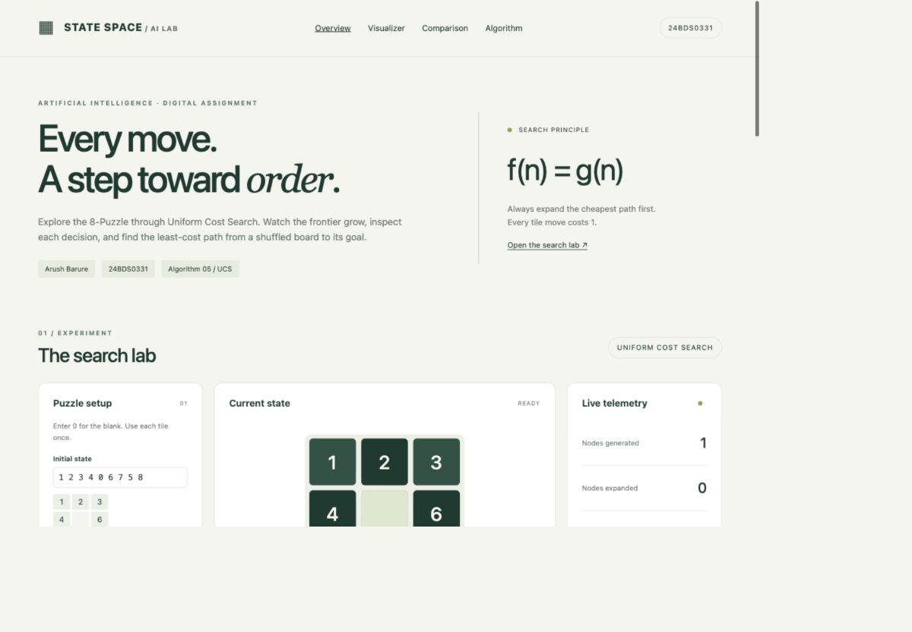
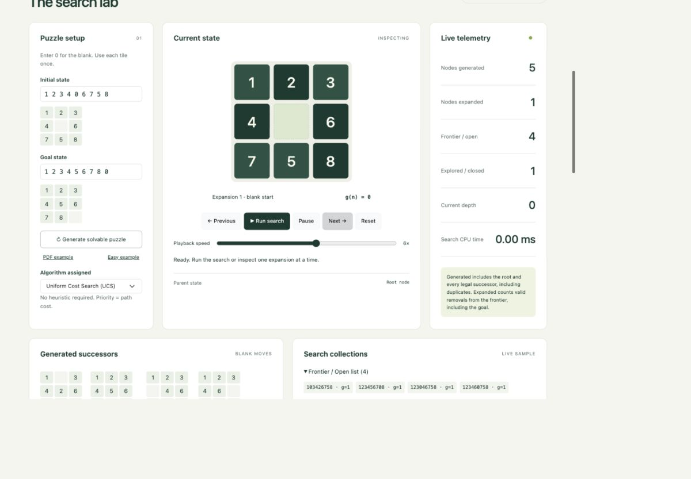
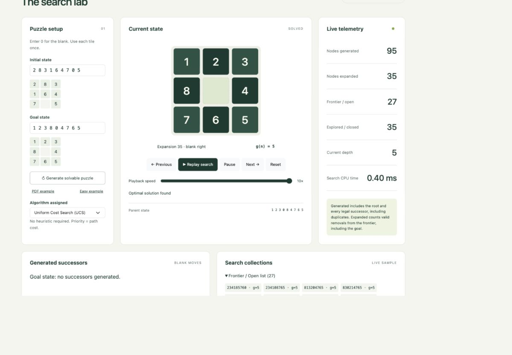

# State Space - Interactive 8-Puzzle UCS Visualizer

**Arush Barure · 24BDS0331 · Artificial Intelligence**  
Assigned algorithm: **5 - Uniform Cost Search (UCS)**

[Open live website](https://arush-barure.github.io/AI-8Puzzle-Visualizer/) · [Assignment PDF](docs/Assignment-24BDS0331.pdf) · [Narrated demonstration](docs/Demonstration-24BDS0331.mp4)

## Project description
An interactive 8-Puzzle solver that makes state-space search visible. Enter any valid initial and goal arrangement, or generate a solvable puzzle. Inspect UCS expanding the minimum-cost frontier, watch legal successors, and animate the optimal solution.

The assignment contains general multi-algorithm requirements but explicitly allocates only one algorithm to each student. The allocation table maps 24BDS0331 to number 5, UCS. **Only UCS is implemented.** The comparison section documents the other methods theoretically and measures only UCS; it does not invent benchmark results.

## Technologies
- HTML5, CSS3 and JavaScript ES6
- Bootstrap 5.3.3 stylesheet, vendored locally (MIT)
- Custom binary min-heap and UCS graph search; no AI/search libraries
- GitHub Pages static hosting; no build or account required to use the app

## Features
- Editable initial/goal states; 0 represents the blank
- Input validation and inversion-parity solvability check for arbitrary goals
- Random solvable generation using legal moves from the current goal
- Initial, goal, current, successor and solution-path boards
- Animated tile movement; reduced-motion preference respected
- Run, pause, resume, next/previous recorded expansion, reset and speed control
- Generated/expanded totals, open/closed counts and previews, parent, depth and cost
- Solution summary and downloadable JSON result
- Algorithm documentation and explicitly theoretical comparison
- Responsive interface and labeled keyboard-accessible controls

## Search algorithm implemented
UCS prioritizes cumulative path cost **f(n) = g(n)**. Every move has cost 1. A stable binary min-heap breaks cost ties by insertion order. Best-known-cost and explored-state structures prevent duplicate expansion. The goal is checked after frontier removal. Parent links reconstruct the optimal path. With unit costs, UCS explores the same depth layers as BFS, while retaining a cost-priority implementation.

UCS is complete here and finds the least-cost solution. General tree-search time/space is O(b^(1 + floor(C*/epsilon))). For a finite graph with a binary heap, search time is O((V + E) log V); the general lazy-entry implementation uses O(V + E) storage. The UI's recording and rendering have additional cost and are excluded from these solver bounds.

## Heuristics used
**None.** UCS uses path cost only. Misplaced Tiles and Manhattan Distance are explained as context for GBFS/A*, but neither is used to rank states in this project. The blank is excluded from both heuristic definitions.

## How to run
Open `index.html` in a modern browser. All stylesheet and script dependencies are local.

Optional local server:
```sh
python3 -m http.server 8000
```
Then visit `http://localhost:8000`.

Run meaningful algorithm checks with Node.js:
```sh
node tests/search.test.cjs
```

## Verified cases
Nine automated checks cover invalid input, already-solved input, one and two move optima, legal solution transitions, the PDF's nonstandard goal example (5 moves), unsolvable parity, random-state parity, nondecreasing expansion cost, and shortest distances for all 90 states within six moves of the standard goal.

Default example: `1 2 3 / 4 0 6 / 7 5 8` to `1 2 3 / 4 5 6 / 7 8 0`: **2 moves**, **23 generated**, **9 expanded**, **maximum discovered depth 3**, with deterministic tie order. Timing varies by device.

## Statistics and practical limits
- Generated: root plus every legal successor candidate, including duplicates.
- Expanded: valid frontier removals, including the goal node.
- Maximum depth: maximum cost/depth discovered, including queued states.
- Search CPU time: accumulated search-step time; excludes playback delays and DOM rendering.
- Approximate memory: 160 bytes per peak stored node/reference unit. This is a rough solver model, **not measured JavaScript heap usage**. It excludes recorded snapshots, DOM and browser overhead.
- Open preview: up to 12 heap entries, sorted within that sample. It is not the entire frontier or necessarily its 12 cheapest entries.
- Previous/Next inspect recorded snapshots without rewinding/mutating the solver. Run resumes or replays that history.
- Hard puzzles can require many expansions and substantial playback-history memory. Use the fastest speed for larger searches. Reset cancels the current run.

## Screenshots




## Repository structure
```text
AI-8Puzzle-Visualizer/
├── index.html
├── css/style.css
├── js/search.js
├── js/app.js
├── assets/bootstrap.min.css
├── images/
├── docs/
│   ├── Assignment-24BDS0331.pdf
│   ├── Demonstration-24BDS0331.mp4
│   └── Demonstration-script.md
├── tests/search.test.cjs
└── README.md
```

## Deployment
GitHub Pages publishes `main` / root. All paths are relative, so project-subdirectory hosting works. To configure: Repository Settings → Pages → Deploy from a branch → main → /(root) → Save.

- Repository: https://github.com/arush-Barure/AI-8Puzzle-Visualizer
- Live website: https://arush-barure.github.io/AI-8Puzzle-Visualizer/
- README: https://github.com/arush-Barure/AI-8Puzzle-Visualizer/blob/main/README.md
- Demonstration: https://github.com/arush-Barure/AI-8Puzzle-Visualizer/blob/main/docs/Demonstration-24BDS0331.mp4

## Student details
- Name: Arush Barure
- Registration: 24BDS0331
- Course: Artificial Intelligence
- Assignment: Interactive 8-Puzzle Problem Solver using AI Search Algorithms
- Allocated method: Uniform Cost Search (5)

## References and acknowledgments
- Source assignment: *Artificial Intelligence QP 1.pdf*, supplied by the student.
- [UC Berkeley CS188 - Uninformed Search](https://inst.eecs.berkeley.edu/~cs188/textbook/search/uninformed.html)
- [UC Berkeley CS188 - Informed Search](https://inst.eecs.berkeley.edu/~cs188/textbook/search/informed.html)
- [Bootstrap 5.3.3](https://github.com/twbs/bootstrap/tree/v5.3.3), Copyright The Bootstrap Authors, MIT license. The vendored CSS retains its license header.
- [GitHub Pages publishing documentation](https://docs.github.com/en/pages/getting-started-with-github-pages/configuring-a-publishing-source-for-your-github-pages-site)
- OpenAI Codex assisted implementation, documentation and testing. Search logic is written from scratch; no search library is used. The demonstration uses synthetic narration and real interface captures. The student should review the code and be able to explain it.
